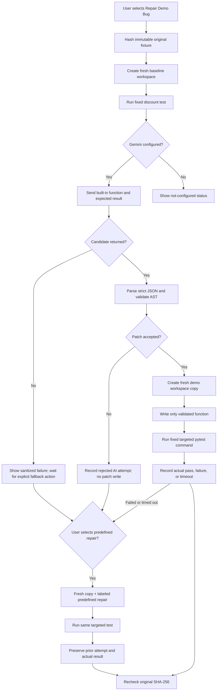

# Architecture

PatchPilot is a local Streamlit application with a small Python workflow layer. It supports one built-in discount example and one targeted test.

## Components

| Component | Responsibility |
| --- | --- |
| `app.py` | Renders the dashboard and calls the workflow only after a user action. Stores the current run and attempt history in Streamlit session state. |
| `patchpilot/config.py` | Loads `AI_PROVIDER`, `GEMINI_MODEL`, `GEMINI_API_KEY`, and timeouts. The provider is currently limited to Gemini. |
| `patchpilot/workflow.py` | Coordinates the baseline, one repair attempt, verification, source integrity, and explicit user-selected predefined retry. |
| `patchpilot/repair_service.py` | Chooses the provider, parses the returned JSON through the validator, and assigns provenance and failure labels. |
| `patchpilot/providers/gemini_provider.py` | Makes the synchronous Gemini Interactions API request with structured JSON output and safe error diagnostics. |
| `patchpilot/patch_validator.py` | Enforces the response schema and Python AST allowlist; writes the accepted function only into an owned workspace. |
| `patchpilot/workspace.py` | Creates a fresh copy of the original fixture and fixed test, and calculates/verifies the fixture SHA-256. |
| `patchpilot/test_runner.py` | Executes the fixed targeted pytest command without a shell, with a controlled child environment and timeout. |

## Request and repair lifecycle

The workflow hashes the original fixture before the run and verifies it after each repair attempt. An integrity mismatch prevents a successful result. Each repair attempt uses a new workspace copied from the original, so retrying does not inherit the previous patched file.

## Data flow

The application reads `examples/buggy_discount.py` and the expected behavior (`100` should become `90`). If the key is present, the provider sends that built-in source and behavior to the configured Gemini model. It requests JSON with exactly `function_source` and `explanation`. It does not send user-selected repositories or read arbitrary project files.

The repair service passes the response string to `parse_proposal_json`. The validator checks JSON keys and types, parses Python syntax, and permits only the expected `apply_discount(price)` function and narrowly allowed arithmetic expression nodes. The accepted source is then written to the `buggy_discount.py` file inside a new workspace under `runtime/demo_workspaces/`. Model instructions, paths, and commands are not accepted.

The test runner invokes `[sys.executable, "-m", "pytest", "tests/test_discount.py", "-q"]` with `shell=False`, the workspace as its current directory, and a configured timeout. A nonzero exit, timeout, or source hash mismatch is not success. Patch-boundary validation and targeted-test verification are separate outcomes.

## Failure paths and state

- Missing key or failure before a candidate is returned: report that reason and offer a separate predefined-repair action. No patch is applied automatically.
- Malformed JSON or disallowed AST: preserve the rejected AI attempt, do not write it, and offer the explicit predefined-repair action.
- Valid AI candidate with a failing or timed-out targeted test: preserve the actual AI result and offer the explicit retry.
- A selected predefined retry starts from a fresh original copy and appends its attempt to the current workflow's transient history.
- **Reset Demo** clears the current result and history. No persistent or multi-run history is implemented.
- API diagnostics contain only elapsed time, exception type, HTTP status, and a sanitized request ID where available. Keys, authorization headers, raw response bodies, and raw exception text are not logged.

See [Security](SECURITY.md) for trust boundaries and limitations.
